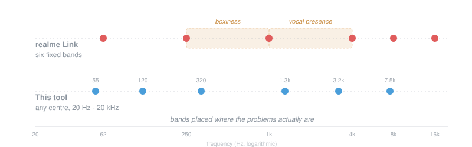

# realme Buds Control

Control realme Buds earbuds directly over Bluetooth, without the official app.

The headline feature: **the equaliser is not limited to six fixed frequencies.**
realme Link only lets you adjust 62/250/1k/4k/8k/16k Hz, but the earbuds store
whatever centre frequencies they are given. That matters because the stock
layout has two awkward gaps — nothing between 250 Hz and 1 kHz, where boxiness
lives, and nothing between 1 kHz and 4 kHz, where vocal presence lives.



## What it does

- **Equaliser** with six bands you can place anywhere from 20 Hz to 20 kHz
- **Dynamic bass engine** — a second processor with its own range, which the
  official app barely exposes
- **Feature toggles** — Hi-Res (LHDC), spatial audio, game mode, wind noise
  reduction and the rest, with unsupported ones greyed out rather than hidden
- **Device info** — firmware version, per-bud battery, region code, and the
  capability bitmap showing what the firmware actually implements
- Settings are written to the earbuds, so they persist across power cycles and
  apply to every device you connect to, not just this computer

## Install

Requires Python 3.10 or newer.

```bash
git clone https://github.com/utkarshhxd/realme-buds-control.git
cd realme-buds-control
pip install -r requirements.txt
```

Pair the earbuds with your computer first. On Windows their SPP service then
appears as a "Standard Serial over Bluetooth link" COM port, which is what this
talks to. The port only exists while the earbuds are actually connected to this
machine — if they have handed the link back to a phone, reconnect them here.

## Use

```bash
python gui.py              # desktop interface
```

Or from the command line:

```bash
python cli.py ports                 # list paired devices
python cli.py info                  # firmware, battery, region, features
python cli.py presets               # show the built-in tunings
python cli.py eq classic            # apply a preset
python cli.py bass 2 1 0            # dynamic bass: low, mid, high
python cli.py feature 24 on         # toggle Hi-Res audio

# or place the bands wherever you want
python cli.py eq --bands 55:1 120:3 320:-2 1300:3 3200:1 7500:-2
```

As a library:

```python
from buds import Buds, EqProfile, find_ports

port = next(p for p in find_ports() if p.is_candidate)
with Buds(port.device) as buds:
    print(buds.firmware(), buds.battery())
    buds.write_eq(EqProfile(eq_id=6, name="Mine",
                            bands=[(55, 1), (120, 3), (320, -2),
                                   (1300, 3), (3200, 1), (7500, -2)]))
```

## Presets

| Preset | For |
|---|---|
| `classic` | 80s/90s — warmth from bass guitar rather than sub-bass, restored midrange, top end eased because masters of that era are already bright |
| `acoustic` | Unplugged material — honest midrange, guitar body boom controlled, air opened up |
| `clarity` | General purpose — cuts the 200 Hz mud these earbuds ship with, lifts 2.5 kHz for vocals |
| `vocal` | Podcasts and vocal-led music |
| `bass` | Electronic and hip-hop — deep sub lift with 200 Hz still cut so it stays tight |
| `flat` | Neutral, bass engine off |

## Protocol

Transport is standard SPP (RFCOMM) on UUID
`00001101-0000-1000-8000-00805F9B34FB`. There is no checksum, encryption or
authentication; being paired is the only requirement.

```
Frame    AA | LEN | CTRL | 00 | [FSN] | payload
Packet   CMD (u16 LE) | SEQ (u8) | LEN (u16 LE) | DATA
```

`LEN` is a 7-bit varint holding `len(payload) + 2`, or `+ 3` when fragmented.
The low two bits of `CTRL` give the fragment state (0 single, 1 first, 2 middle,
3 last); fragmented frames insert a sequence byte before the payload. Bit 15 of
`CMD` marks a response, and the first byte of a response's data is a status
code where zero means success.

| Command | Purpose |
|---|---|
| `0x0100` | capability bitmap |
| `0x0105` / `0x0106` | firmware version / battery |
| `0x010D` / `0x0403` | read / write switch features |
| `0x010C` / `0x0404` | read / write ANC state |
| `0x0120` | region code |
| `0x0122` / `0x0418` | read / write custom equaliser |
| `0x0124`, `0x012C` / `0x041B` | read / write bass engine |

Custom EQ payload (`0x0418`):

```
action | min_gain | max_gain | eq_id | name_len | name | n_bands |
    (centre_hz u16 LE, gain s8) x n_bands
```

Action 1 adds, 2 modifies, 3 deletes. Writing a profile also makes it active.

### Firmware limits, measured rather than assumed

- Band **centre frequencies are stored exactly as sent** — this is the limit
  that exists only in the app
- **Gain is capped at ±6 dB.** A wider range is rejected with status `1`
- The bass engine is a separate processor with its own ±5 dB range
- A capability bit being set does not guarantee a working feature. On the
  Buds Air8, the bits for the hearing-enhancement and ear-scan commands are
  set and the feature toggle flips, but no command in that subsystem ever
  responds — the switch exists, the engine behind it does not

## Compatibility

Developed against a **realme Buds Air8** on firmware 1.1.0.104. The protocol is
shared across realme's `VENDOR_TL` earbuds, so other models in that family are
likely to work, with per-model variation in which features exist. Run
`python cli.py info` to see what your pair reports.

Port discovery reads device names from the Windows registry. On Linux and macOS
ports are listed by description instead, and you can pass `--port` explicitly.

## Notes

- Opening realme Link's equaliser or sound-effect screens will overwrite
  settings made here with the app's own fixed-frequency bands
- Everything this writes is a setting, and all of it is reversible — run
  `python cli.py eq flat` and `python cli.py bass --off` to return to stock
- Nothing here touches firmware or the update path

## Licence

MIT
